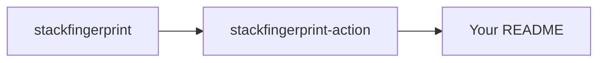

Your GitHub profile README is the page people land on when they click your avatar from a PR, an issue or a commit. Most visitors give it five seconds. The goal isn't to fit everything in: it's to answer **who you are, what you build and where to look next**.

Here are 25 sections you can mix and match, grouped by what they do. Pick five or six, not all 25.

<Callout type="tip" title="Quick setup">
  Create a public repository with **exactly your username** as its name (e.g.
  `octocat/octocat`) and add a `README.md`. GitHub shows it at the top of your
  profile automatically.
</Callout>

## Introduce yourself

### 1. A one-line intro that says what you do

Skip "Hi there 👋, I'm a passionate developer". Say what you actually build:

```markdown
# Hi, I'm Sam

I build developer tools and open-source GitHub Actions. Currently working on
[Stack Fingerprint](https://github.com/mattqdev/stackfingerprint).
```

### 2. "Currently" bullets

Three short lines age better than a long bio, and they're easy to update:

```markdown
- 🔭 Working on: a README stack card generator
- 🌱 Learning: Rust and WebAssembly
- 💬 Ask me about: Next.js, CI pipelines, SVG
```

### 3. How to reach you

One line of links beats a row of twenty social icons. Link the two or three places where you actually answer.

### 4. An animated typing headline

[readme-typing-svg](https://github.com/DenverCoder1/readme-typing-svg) renders a typing animation as an SVG image. Use it for one line, at most: motion pulls the eye away from everything else.

### 5. A "now" or status line

GitHub's own profile status (the emoji next to your name) is great for short-lived updates like "on vacation" or "open to work", and it doesn't need a commit.

## Show your stack

### 6. A stack card per flagship project

Instead of one giant wall of logos, show the stack **of the projects you want people to look at**. Each card is detected from the repo itself, so it stays accurate:

<StackCard repo="mattqdev/stackfingerprint" layout="banner" theme="midnight" />

<EmbedSnippet layout="banner" theme="midnight" />

### 7. Only the essentials

Profile READMEs get crowded quickly. The `top` filter keeps just languages and frameworks, max five:

<StackCard repo="vercel/next.js" categoryFilter="top" theme="obsidian" />

<Snippet
  code={`[](https://stackfingerprint.vercel.app/?repo=OWNER/REPO)`}
/>

### 8. Hand-picked badges for the tools you know (not the ones you used once)

Static badges are fine for a skills list, as long as you prune them. Every [technology page](/tech) has a ready-made badge, e.g. [TypeScript](/tech/typescript), [Python](/tech/python) or [Docker](/tech/docker).

### 9. Cards that commit themselves

If you'd rather not hotlink images from a third-party domain, a GitHub Action can generate the card and commit the SVG. See [Automate your README's tech stack with GitHub Actions](/blog/automate-readme-stack-card-github-action).

### 10. A different look for each project

Use the same layout for every card, but vary the theme to tell projects apart at a glance. The [builder](/) previews all of them on your repo.

## Showcase your work

### 11. Pin your best repositories

Before adding anything to the README, use GitHub's **Customize your pins** (up to six). Pinned repos sit right below the README and already show stars and language.

### 12. A projects table

A small table scans faster than paragraphs:

```markdown
| Project                                                                        | What it does                          |
| ------------------------------------------------------------------------------ | ------------------------------------- |
| [stackfingerprint](https://github.com/mattqdev/stackfingerprint)               | Turns any repo into a tech stack card |
| [stackfingerprint-action](https://github.com/mattqdev/stackfingerprint-action) | Commits that card to your README      |
```

### 13. Screenshots or a GIF of one project

One short GIF of your best project is worth more than a list of ten. Keep it under a few MB: large GIFs load slowly on GitHub.

### 14. "Good first issues" in your repos

If you maintain projects, link a filtered issues search. It turns visitors into contributors:

```markdown
Want to contribute? Check the
[good first issues](https://github.com/mattqdev/stackfingerprint/issues?q=is%3Aopen+label%3A%22good+first+issue%22).
```

### 15. Live demo links

If a project has a website, link it directly next to the repo. People click demos far more than source code.

## Keep it fresh automatically

### 16. Latest blog posts

[blog-post-workflow](https://github.com/gautamkrishnar/blog-post-workflow) is a GitHub Action that pulls posts from an RSS feed into your README on a schedule. Mark the spot with two comments:

```markdown
## Latest posts

<!-- BLOG-POST-LIST:START -->
<!-- BLOG-POST-LIST:END -->
```

### 17. Weekly coding time

[waka-readme](https://github.com/athul/waka-readme) writes your WakaTime stats (languages, editors, hours) into the README via an Action.

### 18. Contribution snake

[Platane/snk](https://github.com/Platane/snk) generates an animation of a snake eating your contribution graph. It's playful and runs entirely in your own Actions.

### 19. An all-in-one metrics image

[lowlighter/metrics](https://github.com/lowlighter/metrics) renders dozens of optional plugins (languages, activity, achievements…) into a single SVG committed by an Action.

### 20. Stats cards

[github-readme-stats](https://github.com/anuraghazra/github-readme-stats) and [github-readme-streak-stats](https://github.com/DenverCoder1/github-readme-streak-stats) show totals, top languages and streaks. Popular public instances can hit rate limits, so consider self-hosting them on Vercel.

## Make it look good

### 21. Dark and light mode images

GitHub supports the `<picture>` element with `prefers-color-scheme`, so you can serve a different image for each theme. Stack cards have light themes (`arctic`, `slate`, `parchment`, `rose`, `lavender`) to pair with dark ones:

<Snippet
  lang="html"
  label="README.md"
  code={`<picture>
  <source media="(prefers-color-scheme: dark)"
    srcset="https://stackfingerprint.vercel.app/api/card?repo=OWNER/REPO&theme=midnight">
  
</picture>`}
/>

### 22. Collapsible sections

Long lists (tools, talks, older projects) can hide behind `<details>`:

```html
<details>
  <summary>Older projects</summary>

  - project-one: a CLI for… - project-two: a VS Code extension for…
</details>
```

Leave a blank line after `<summary>` so the Markdown inside renders.

### 23. Centered header block

GitHub strips CSS, but `<div align="center">` still works for a centered title, avatar or banner.

### 24. A diagram instead of a paragraph

GitHub renders [Mermaid](https://mermaid.js.org) code blocks, handy to show how your projects fit together:

````markdown

````

### 25. A clear call to action at the end

End with the one thing you want visitors to do: star a project, read a post, or get in touch. One link, not five.

## What to leave out

- **Twenty badges for every tool you've touched.** It reads as noise. Keep the ones you'd be happy to be interviewed on.
- **Too many animations.** One moving element is fun; four compete with each other.
- **Images that break.** Third-party image services go down or hit rate limits. Prefer images committed to your repo by an Action, or services you can self-host.
- **Stale numbers written by hand.** If it can change, automate it or remove it.

## A simple template to start from

```markdown
# Hi, I'm <name>

I build <what you build>. Currently working on [<project>](link).

- 🔭 Working on: …
- 🌱 Learning: …
- 💬 Ask me about: …

## Projects

[](https://stackfingerprint.vercel.app/?repo=OWNER/REPO)

## Latest posts

<!-- BLOG-POST-LIST:START -->
<!-- BLOG-POST-LIST:END -->

📫 <one contact link>
```

<TryIt>Generate a card for your flagship repo →</TryIt>
